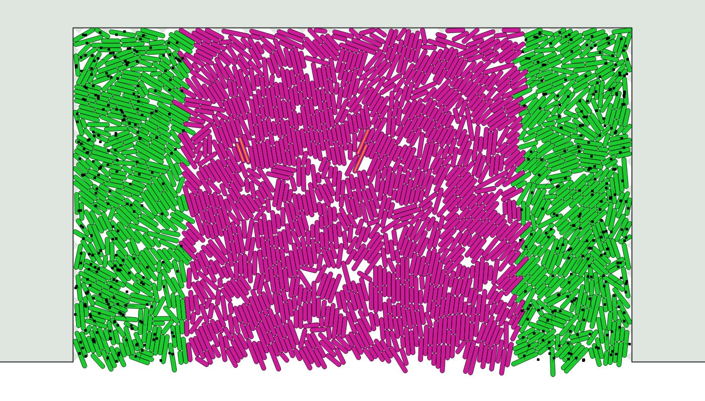

::: {.hero}
{fig-alt="The chamber full of rod-shaped cells after 60 000 steps: green cells near the side walls, magenta cells in the centre, black anchor points near the walls."}

::: {.hero-text}
Bacteria grow, divide and push each other in a chamber open at the bottom, until they are swept
out into the channel below. Each cell is a rigid capsule in the [Rapier](https://rapier.rs)
physics engine, which resolves the pushing; a few hundred lines of model code do the growing,
dividing and dying.

This site is the program itself: every line of code appears here, in an order that explains it,
and the source files are generated from these pages.

[Run the simulation](simulation/index.html){.btn .btn-primary .btn-lg role="button"}
:::
:::

## What is simulated

A monolayer of rod-shaped bacteria lives in a microfluidic chamber, 100 × 60 units, closed on three sides and open at the bottom, where a channel carries away
whatever leaves. Seen from above:

- **Cells** are capsules 0.8 units wide. Each grows in length, and divides into two unequal
  daughters when it reaches a length drawn at birth. Cells occasionally die at random.
- **Mechanics.** Growing cells push their neighbours. The physics engine keeps cells from passing
  through each other and through the walls; drag makes them stop as soon as nothing pushes them,
  as in a viscous medium.
- **The walls.** Within 20 units of the side walls, cells may attach to the surface with a soft
  spring that lets go after a while, or when the colony drags the cell too far.
- **The exit.** The colony fills the chamber in about 12 000 steps and then holds 1700–1800 cells,
  with the surplus flowing out through the bottom.

The simulation records the position, orientation and length of every cell at regular intervals,
together with the family tree, for analysis.

## How the program is organised

```{mermaid}
flowchart TB
  subgraph entry["Entry points"]
    run["run.ts<br/>command line"]
    viewer["viewer.ts + index.html<br/>browser"]
  end
  render["render.ts<br/>drawing"]
  sim["simulation.ts<br/>the model on Rapier"]
  overlap["overlap.ts<br/>overlap check"]
  model["model.ts<br/>parameters, geometry, formulas"]
  states["states.ts<br/>recorded states"]
  rng["rng.ts<br/>random numbers"]
  rapier[("Rapier<br/>physics engine")]
  run --> sim
  run --> overlap
  viewer --> sim
  viewer --> overlap
  viewer --> render
  sim --> model
  sim --> states
  sim --> rng
  sim --> rapier
  overlap --> model
  render --> model
```

Each chapter of this site is one source file. Read them in this order:

| Chapter | File | What it covers |
|---|---|---|
| [The model](model.qmd) | `src/model.ts` | every parameter and why it has its value; the chamber; mass, drag and orientation of a cell |
| [The simulation](simulation.qmd) | `src/simulation.ts` | the core: cells as Rapier bodies, one step, growth, division, anchors, a Rapier bug and its workaround |
| [Randomness and records](recording.qmd) | `src/rng.ts`, `src/states.ts` | reproducible runs, and the format of the recorded states |
| [Measuring overlaps](overlap.qmd) | `src/overlap.ts` | how deep cells press into each other: the measure the solver is tuned against |
| [The command-line runner](cli.qmd) | `src/run.ts` | long runs, safe saving, progress and validation |
| [The browser viewer](browser.qmd) | `index.html`, `src/viewer.ts` | the live page: controls, URL settings, saving from a browser |
| [Drawing the chamber](rendering.qmd) | `src/render.ts` | the simple and diagnostic views, drawn fast |

The model, the simulation and the modules it uses run unchanged in Node.js and in the browser;
only the two entry points touch either environment. The [development notes](NOTES.md) and the
[overlap report](reports/overlap-report.md) record how the model reached its current form and how
it was validated.

## How to read this site

The code is cut into named pieces, each shown where it is explained. A piece of code that
contains a line like *«sim-step»* includes, at that point, the piece named `sim-step`; click the
name to jump to it. The headers above the code say what each piece is:

- 📄 **`src/model.ts`**: the outline of a source file, which pulls in its pieces;
- **«model-params-growth»**: a named piece;
- **«model-params-growth» +=**: more code appended to a piece of that name, explained separately.

Nothing in the source files is missing from these pages, and nothing on these pages is left out
of the source files: the files contain no comments, because this site is their documentation.

## Working on the code

The pages of this site (`docs/*.qmd`) are the source. [Entangled](https://entangled.github.io)
extracts ("tangles") the code from them into `src/` and `index.html`; TypeScript compiles `src/`
into `build/`; [Quarto](https://quarto.org) renders the pages into this site.

```{mermaid}
flowchart LR
  qmd["docs/*.qmd<br/>(edit these)"] -- "npm run tangle<br/>(Entangled)" --> src["src/*.ts<br/>index.html"]
  src -- "npm run build<br/>(TypeScript)" --> js["build/*.js"]
  js --> sim(["simulation<br/>Node.js or browser"])
  qmd -- "npm run docs<br/>(Quarto)" --> site(["this site"])
```

```sh
npm install                       # Rapier and TypeScript
pip install entangled-cli         # for npm run tangle
npm run tangle                    # docs/*.qmd -> src/*.ts, index.html
npm run build                     # src/*.ts -> build/*.js
npm start                         # the simulation in the browser
node build/run.js --steps 3000    # or on the command line
npm run docs                      # this site, in docs/_site (needs Quarto)
```

Edit the `.qmd` files, never the generated files: `npm run tangle` overwrites them. The generated
files are committed, so the simulation can be built and run without Entangled or Quarto; a check
on every push makes sure they match the pages.
